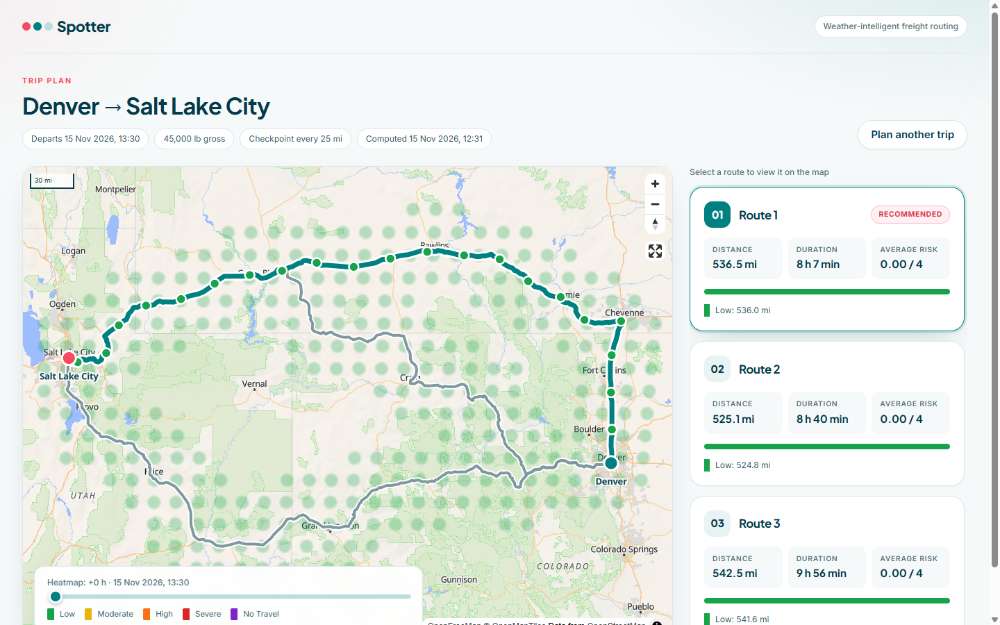

# Spotter — Weather-Aware Truck Routing

Spotter helps a truck driver or dispatcher choose the safest route between two places. It gets up
to three truck routes, checks the forecast weather at the hour the truck will reach each point along
the way, factors in the load weight, and ranks the routes from safest to riskiest.



- **How to use it, step by step with screenshots:** [`docs/USER_GUIDE.md`](docs/USER_GUIDE.md)
- **Product specification:** [`docs/SPEC.md`](docs/SPEC.md)

---

## Features

| Feature | What it does |
|---|---|
| Place search | Origin and destination autocomplete (HERE Autosuggest, called through the backend so the API key never reaches the browser). |
| Truck routing | Up to 3 truck-legal routes from HERE Routing v8, using the gross weight. Shows a notice if fewer than 3 come back. |
| Checkpoints | A weather checkpoint every 10, 25 or 50 miles plus the destination, each with its own arrival time (ETA). |
| Forecast at arrival time | Each checkpoint uses the WeatherAPI.com hourly forecast for the hour nearest its ETA, not the weather "now". ETAs come from HERE's truck travel time for each road segment, not from an assumed speed. |
| Risk levels | Every checkpoint is rated Low, Moderate, High, Severe or No Travel from wind, rain and snow, with stricter wind rules for heavy loads. |
| Route ranking | Routes are ranked by No Travel miles, then Severe miles, High miles, average risk, and finally travel time. The best one is marked **Recommended**. |
| Route cards | Distance, duration, average risk, a coloured bar of miles at each risk level, and a warning if any part is No Travel. |
| Interactive map | Detailed map with the start and end points marked. The selected route is shown in teal and the map zooms to it. Click a card or a route line to switch routes. |
| Checkpoint details | Click any checkpoint to see its ETA, mile marker, wind (with gusts), rain, snow, and what caused its risk level. |
| Weather heatmap | A risk heatmap on a ~50 mi grid around the routes (up to ~60 points), from departure up to 48 h ahead, or as far as the forecast reaches. Drag the slider to see how conditions change. |
| Stateless | Nothing is stored. Each plan is computed on request and shown straight away, with the time it was computed. |
| Responsive | Works on phones, tablets and desktops. |

### Risk rules

| Condition | Low | Moderate | High | Severe | No Travel |
|---|---|---|---|---|---|
| Sustained wind (mph) | < 25 | 25 – < 35 | 35 – < 45 | 45 – < 55 | ≥ 55 |
| Rain (in/hr) | < 0.10 | 0.10 – < 0.25 | 0.25 – < 0.50 | 0.50 – 1.00 | > 1.00 |
| Snow (in/hr) | < 0.5 | 0.5 – < 1.0 | 1.0 – < 2.0 | 2.0 – 3.0 | > 3.0 |

Load rules for wind:
- 45 – < 55 mph with more than 30,000 lb → No Travel.
- 35 – < 45 mph with more than 40,000 lb → Severe.

A checkpoint takes the worst of its wind, rain and snow levels.

---

## Tools and technologies

### Backend
| Tool | Used for |
|---|---|
| Python 3.13 | Language |
| Django 6.1 | Web framework, ORM, migrations |
| Django REST Framework 3.18 | REST API, serializers, validation |
| httpx | HTTP client for HERE and WeatherAPI.com |
| python-dotenv | Configuration from environment variables / `.env` |
| django-cors-headers | Allows the frontend to call the API |
| gunicorn, WhiteNoise | Production server and static files |
| pytest, pytest-django, respx | Tests (respx mocks external HTTP calls) |
| Ruff | Linting and formatting |

### Frontend
| Tool | Used for |
|---|---|
| React 19 + TypeScript 6 | UI |
| Vite 8 | Dev server and build |
| React Router 7 | Pages (`/` planner and `/trip` result) |
| TanStack Query 5 | Server state: fetching, caching and mutations |
| MapLibre GL 6 | Interactive vector map |
| Vitest + React Testing Library + jsdom | Tests |
| ESLint + Prettier | Linting and formatting |

### External services
| Service | Used for |
|---|---|
| HERE Routing API v8 | Truck routes (needs `HERE_API_KEY`) |
| HERE Autosuggest API | Place search |
| WeatherAPI.com | Hourly forecast: wind, gusts, rain, snow (free plan, needs `WEATHERAPI_KEY`) |
| OpenFreeMap | Map tiles and style |
| Render | Hosting (Blueprint in `render.yaml`) |

---

## Architecture

```
frontend/ (React + TypeScript + Vite)          backend/ (Django + DRF)
  src/features/trips/                            trips/
    api/        HTTP calls                         domain/        pure rules: risk, load rules, metrics,
    hooks/      TanStack Query, form, map,                        ranking, checkpoints, forecast hour, grid
                route selection                    services/      use cases: TripPlanner, HeatmapService,
    components/ rendering only                                    TripService; ports (Protocols)
    map/        GeoJSON + MapLibre layers          clients/       HERE routing/autosuggest, WeatherAPI,
  src/shared/   http client, Field, formatting                    flexible-polyline decoder, cached fetcher
                                                   api/           serializers, thin views, error mapping,
                                                                  composition root (dependencies.py)
```

- Dependencies point `api → services → domain`. Clients and repositories implement the service
  ports and are wired together in `trips/api/dependencies.py`, so services are tested with fakes.
- When a trip is created (`POST /api/trips`), the backend:
  1. validates the input,
  2. fetches the routes,
  3. places checkpoints along them,
  4. fetches the weather for each point in parallel (retried once),
  5. rates and ranks the routes,
  6. builds the 49-hour heatmap,
  7. returns the plan with `201` (nothing is saved).
- There is no database. Provider responses are cached in memory per server process: weather for
  1 hour, routes and suggestions for 24 hours. The cache is cleared when the server restarts.

### API

| Method | Path | Result |
|---|---|---|
| `POST` | `/api/trips` | `201 {computed_at, inputs, plan, heatmap}` |
| `GET` | `/api/autosuggest?q=` | `[{label, lat, lon}]` |
| `GET` | `/api/health` | `{"status": "ok"}` |

Errors: `400` for invalid input (with messages per field), `422` when no route is found, `502` when a
provider is unavailable. A route is never returned without weather.

---

## Running locally

Requirements: Python 3.13 and Node 22+. No database is needed.

```bash
cp .env.example .env            # set HERE_API_KEY and WEATHERAPI_KEY

cd backend
python -m venv .venv && .venv/Scripts/activate   # macOS/Linux: source .venv/bin/activate
pip install -r requirements-dev.txt
python manage.py runserver      # http://localhost:8000

cd ../frontend
npm install
npm run dev                     # http://localhost:5173
```

The frontend calls `http://localhost:8000` unless `VITE_API_URL` is set.

## Tests and checks

```bash
cd backend  && pytest && ruff check .
cd frontend && npm test && npm run lint && npm run build
```

## Deployment (Render + GitHub Actions)

Deploys run from the **`Deploy`** branch. Every push to it runs
[`.github/workflows/deploy.yml`](.github/workflows/deploy.yml):

1. **Backend tests**: ruff lint and format check, `manage.py check`, pytest.
2. **Frontend tests**: ESLint, Vitest, production build.
3. **Deploy**: only if both jobs pass, it calls the Render deploy hooks for the API and the site.

You can also start it by hand under **Actions → Test and deploy → Run workflow**.

### One-time setup
1. In Render, choose **New → Blueprint** and select this repo. `render.yaml` creates `spotter-api`
   (Django + gunicorn) and `spotter-web` (static React site). Both build from the `Deploy` branch,
   with auto-deploy turned off so only the workflow deploys.
2. Set these environment variables in Render:
   - `spotter-api`: `HERE_API_KEY`, `WEATHERAPI_KEY`, and `CORS_ALLOWED_ORIGINS` set to the site URL.
   - `spotter-web`: `VITE_API_URL` set to the API URL.
3. Copy each service's **Settings → Deploy Hook** URL into the GitHub repo secrets (**Settings →
   Secrets and variables → Actions**):
   - `RENDER_DEPLOY_HOOK_API`
   - `RENDER_DEPLOY_HOOK_WEB`

To release, merge `main` into `Deploy` and push.

On the free plan, the API sleeps when idle, so the first request can take about 50 seconds.

## Not included

Authentication, saved or shareable trips, multiple stops, a custom routing engine, live-traffic re-routing, notifications,
and a native mobile app.
