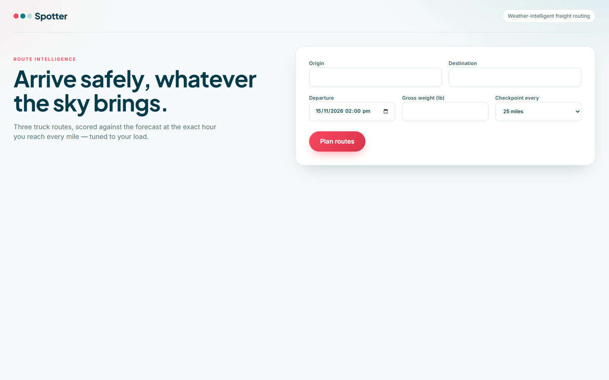
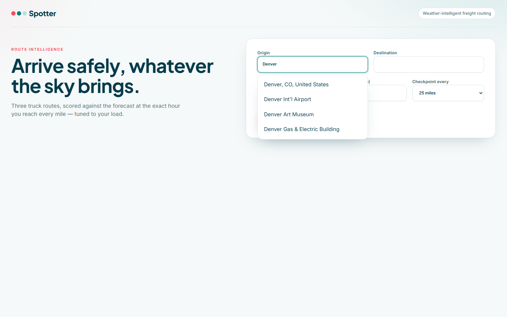
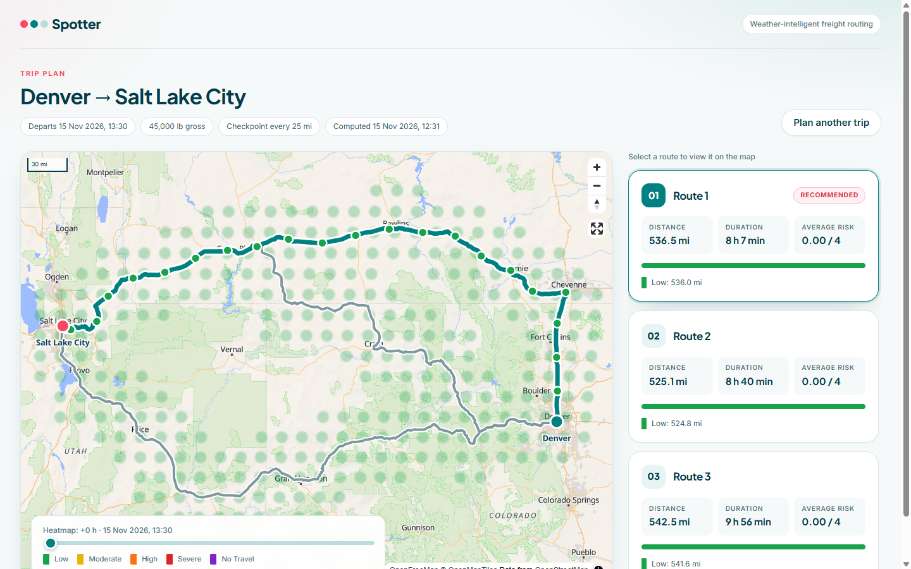
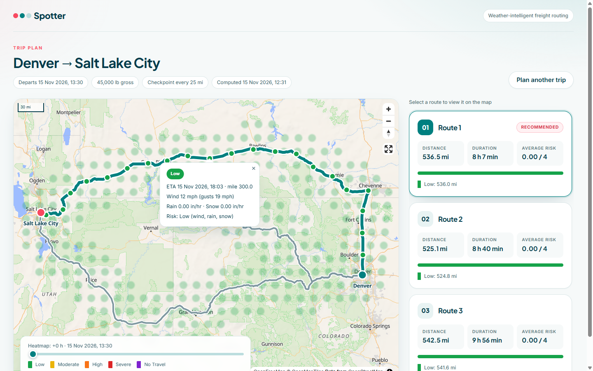
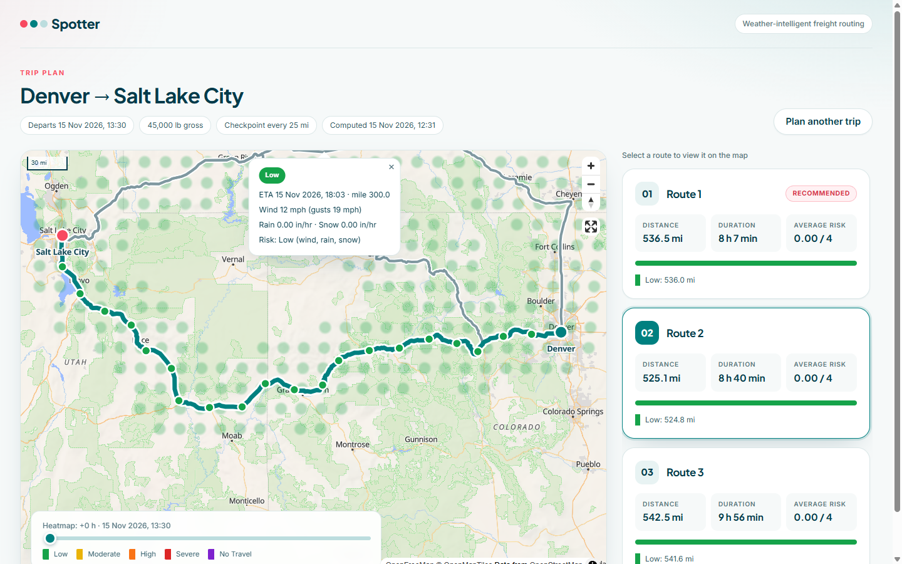
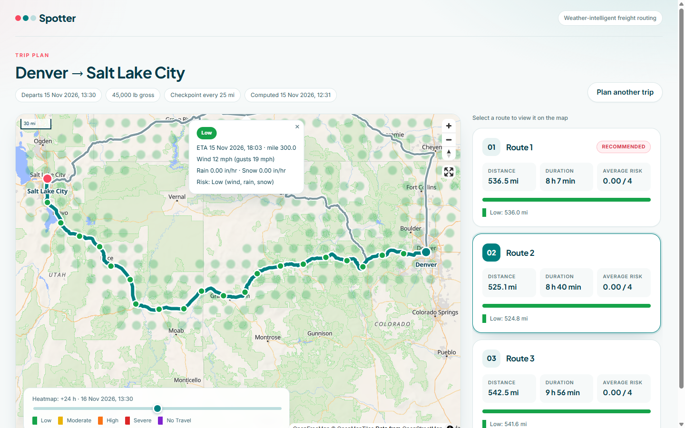
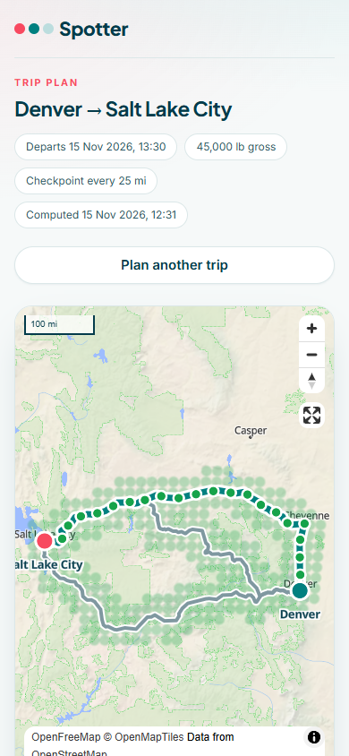
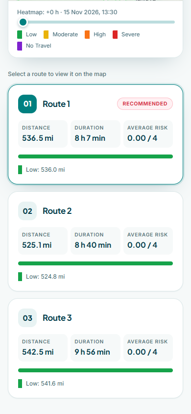

# Spotter User Guide

This guide walks through planning a trip and reading the results.

## 1. Plan a trip

Open the app. The planner form has five fields:

| Field | What to enter |
|---|---|
| Origin | Where the truck starts. Pick a place from the suggestions. |
| Destination | Where the truck is going. Pick a place from the suggestions. |
| Departure | Date and time the truck leaves: from 1 hour ago up to 7 days ahead. |
| Gross weight (lb) | Total weight of truck plus load, up to 80,000 lb. Heavier loads get stricter wind rules. |
| Checkpoint every | How often to check the weather along the route: 10, 25 or 50 miles. |

## 2. Choose places from the suggestions

Start typing a city, address or landmark, then click a suggestion. You have to pick a suggestion,
because it carries the exact coordinates used for routing.

Click **Plan routes**. Spotter fetches the truck routes and the forecast, rates each route, and
opens the trip page.

## 3. Read the trip page

- **Header:** the route name, departure time, weight, checkpoint spacing, and when the plan was
  computed. **Plan another trip** takes you back to the form.
- **Map:**
  - The start is the teal dot and the destination is the coral dot.
  - The selected route is the thick teal line, with its weather checkpoints shown as coloured dots.
  - The other routes are thin grey lines.
  - The map has zoom buttons, a fullscreen button and a distance scale.
- **Route cards (on the right):**
  - Routes are ranked from safest (01) to riskiest. The safest is marked **Recommended**.
  - Each card shows distance, duration and average risk (0 = Low, 4 = No Travel).
  - A coloured bar and list show how many miles fall in each risk level.
  - A red warning appears if any part of the route is rated No Travel.

## 4. Check a checkpoint

Click any coloured dot on the selected route. A popup shows:
- the risk level,
- the ETA and mile marker,
- sustained wind and gusts,
- rain and snow rates,
- which conditions caused the rating.

## 5. Compare routes

Click a route card, or click a grey route on the map. That route becomes the teal line, the map
zooms to it, its checkpoints appear, and its card is outlined in teal.

## 6. See how the weather changes

The heatmap shows risk around the routes. Drag the slider at the bottom of the map from **+0 h** to
**+48 h** after departure to watch storms move. The legend gives the colour for each level, from
Low (green) to No Travel (purple).

## 7. Share a trip

Every trip is saved. Copy the browser address (`/trips/<id>`) and send it to anyone. They will see
the same plan, together with the time it was computed.

## 8. On a phone

The layout stacks into one column. The map comes first, with the heatmap slider under it, followed
by the route cards. Everything works by tapping.

| Map | Route cards |
|---|---|
|  |  |

## Risk levels

| Level | Colour | Meaning |
|---|---|---|
| Low | Green | Normal driving |
| Moderate | Yellow | Use caution |
| High | Orange | Hazardous: consider delaying or another route |
| Severe | Red | Dangerous for trucks |
| No Travel | Purple | Do not drive this section |
